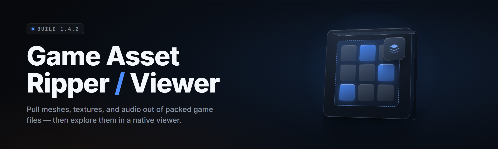

  
  
  

  

  
  
  
  

---

**Pull the art out of the game. View it, convert it, keep it — no engine install, no SDK, no guesswork.**

I built this because I got tired of digging through .pak files with a hex editor at 2am trying to find one character mesh. Months on my main went into the container parsers, and it finally does what I wanted: drop a game folder on it, watch assets fall out the other side.

---

## 🧠 What Is Game Asset Ripper / Viewer

Game Asset Ripper / Viewer is a Windows desktop `.exe` that reads game container formats, extracts textures, meshes, audio, and UI atlases, and lets you preview them in-app before exporting to standard formats. It is a ripper first and a viewer second — the extraction engine and the preview window are the same pipeline, so what you see is what you already pulled.

| Term | Explanation |
|------|-------------|
| Container | The archive a game packs its assets into — `.pak`, `.bundle`, `.assets`, `.vpk`, `.dat`, etc. |
| Dumper | The module that walks a container's index and writes raw asset blobs to disk. |
| Viewer | The in-app preview pane that decodes a blob and renders it without an external editor. |
| Atlas | A single texture holding many small sprites (UI, icons) with a companion coordinate map. |
| Mip chain | The stacked downscaled copies of a texture stored alongside the base level. |
| Swizzle | Console-era texture byte reordering that must be undone before an image is readable. |
| Reimport | Writing an edited asset back into the container for mod use. |

- Decode-first pipeline: every extracted file is validated and previewed before it hits disk.
- Format-agnostic containers: one UI, many parsers, swap them without reinstalling.
- No engine runtime required — the `.exe` carries its own decoders.
- Batch extraction: point it at a folder, get a mirrored output tree.
- Preview-before-export so you never dump 40GB of mips you didn't want.
- Runs from a single folder — extract, launch, done.

---

## 🧩 Overview

| Category | Details |
|----------|---------|
| Product type | Windows desktop `.exe` — ripper + in-app viewer |
| Primary use | Extract, preview, and convert game assets for modding, study, and personal archives |
| Container support | 30+ formats across Unreal, Unity, Source, custom engines |
| Output formats | PNG, DDS, TGA, OBJ, FBX, WAV, OGG, JSON |
| Interface | Native Win32 window, tabbed browser, thumbnail grid, single-asset detail view |
| Distribution | Public GitHub page → landing page → download → extract → run |

The project started as a set of throwaway Python scripts for one Unreal title and grew into a unified tool because every other game needed the same four things: find the container, parse its index, decode the payload, show it to me. That loop is the whole product now, generalized across engines.

---

## ⬇️ Get the Ripper

Grab the current build, extract it, launch the `.exe`. Nothing to install, no package manager, no engine SDK.

  

---

## 🛠️ The Problem

- Container formats are undocumented and change between game patches, so old scripts rot fast.
- Hex editors show you bytes, not pictures — you cannot tell a mesh from a font without decoding it.
- Most rippers dump everything and leave you sorting 60,000 files by hand.
- Texture swizzling and mip chains make "raw" exports look like static garbage.
- Audio is scattered across container chunks with no filenames attached.
- Cross-engine work means juggling five tools that each speak one format.
- Viewer tools and ripper tools are usually separate downloads that disagree on output.

---

## ✅ The Solution

| Problem | Solution |
|---------|----------|
| Formats change between patches | Parser modules are versioned and hot-swappable per engine build |
| Hex editors can't show images | Built-in decoder previews every asset before export |
| Dumping everything is chaos | Category filters + preview-before-export you control at the file level |
| Swizzled textures look broken | Automatic swizzle detection and de-swizzle on decode |
| Audio has no filenames | Container-chunk audio recovered with inferred names and header sniffing |
| Too many single-engine tools | One UI, 30+ parsers, unified output tree |
| Ripper and viewer disagree | Same pipeline drives both — preview is the export path |

---

## 🚀 Key Features

| Feature | Description | Benefit |
|---------|-------------|---------|
| Container browser | Tree view of every indexed asset inside a container | See the whole archive before you touch it |
| Live texture decode | BC1–BC7, ASTC, ETC2, plus uncompressed formats | No more static-noise exports |
| Mesh preview | Wireframe + shaded viewport with vertex/tri counts | Confirm it's the right model instantly |
| Audio scrubber | Waveform playback with header-sniffed codecs | Find the track you want by ear |
| Batch export | Filter by type, size, or name pattern and dump | One click for an entire category |
| Reimport pipeline | Write edited assets back into the container | Mod without a second tool |
| Swizzle engine | Console-era reorder tables built in | Correct pixels on first export |
| Atlas splitter | Cuts a spritesheet using its coordinate map | Usable sprites, not a jigsaw |
| Name recovery | Infers asset names from index strings and hashes | Files you can actually recognize |
| Preset profiles | Save per-game settings and reload them | Repeat work in two clicks |
| Duplicate finder | Hash-compares assets across containers | Kill the bloat before export |
| CLI mode | Headless batch runs from a script | Automation for big archives |

### 🖼️ Textures & Materials

Textures are the most-requested asset and the most punishing to get right — every engine stores them a little differently, and half of them arrive swizzled. The decoder here normalizes all of that before you ever see a pixel.

- **Block-compressed decode** — BC1/BC3/BC4/BC5/BC6H/BC7, ASTC 4x4 through 12x12, ETC1/ETC2/EAC.
- **Mip selection** — export base level only, full chain, or a specific mip you pick.
- **Channel view** — inspect R, G, B, A separately for mask and roughness maps.
- **Material regrouping** — reassemble which textures a material references.

### 🧊 Meshes & Skinned Rigs

Mesh parsing is where a ripper earns its name. Bones, weights, and index buffers all live in different places, and the viewer has to stitch them back into something you can rotate.

- **Index-buffer reconstruction** — 16/32-bit, triangle strips and lists both handled.
- **UV and normal layers** — full vertex attribute recovery.
- **Skeleton preview** — bone hierarchy drawn over the shaded mesh.
- **OBJ/FBX export** — with optional bone weights preserved.

### 🔊 Audio & Voice

Audio rarely ships with filenames, so recovery leans on header sniffing and chunk heuristics. The scrubber lets you confirm by ear before you commit a single byte to disk.

- **Codec sniffing** — Wwise, FMOD, XAudio, Vorbis, Opus, ADPCM.
- **Waveform scrub** — click to seek, loop a region to isolate it.
- **Container-chunk walker** — recovers audio embedded in mixed asset bundles.
- **Batch transcode** — WAV or OGG on export.

### 🎨 UI, Sprites & Flat Assets

UI assets are small and numerous, which makes them the worst to sort by hand. The atlas splitter and font decoder turn a sea of tiny files into something usable.

- **Atlas split by map** — coordinate data drives the cut, not guesswork.
- **Font bitmap + glyph decode** — recover the character set and UVs.
- **Nine-slice metadata** — preserved on export where present.
- **Sprite naming** — pulled from atlas map entries.

---

## 📊 Comparison

| Aspect | Typical Alternative | This Tool |
|--------|--------------------|-----------|
| Format coverage | One engine per tool | 30+ parsers, one UI |
| Preview | External image editor | Built-in decoder pane |
| Swizzle handling | Manual scripts | Automatic on decode |
| Naming | Hash filenames | Index-string recovery |
| Batch control | Dump everything | Filter + preview-before-export |
| Audio | Separate tool | Same pipeline, scrubber included |
| Reimport | Rarely supported | Edit → write back to container |
| Automation | GUI only | Headless CLI mode |

---

## 🧾 All Modules Status

| Module | Status | Description |
|--------|--------|-------------|
| `pak_index` | ✅ Working | Unreal `.pak` index parser and blob extractor |
| `bundle_reader` | ✅ Working | Unity asset bundle reader |
| `vpk_walker` | ✅ Working | Source VPK directory walker |
| `dat_scan` | ✅ Working | Custom `.dat` container scanner |
| `tex_bc` | ✅ Working | BC1–BC7 block decode |
| `tex_astc` | ✅ Working | ASTC 4x4–12x12 decode |
| `tex_etc` | ✅ Working | ETC1/ETC2/EAC decode |
| `swizzle_engine` | ✅ Working | Console reorder table reversal |
| `mesh_index` | ✅ Working | Index-buffer reconstruction |
| `mesh_skin` | ✅ Working | Bone weight and skeleton recovery |
| `mesh_export` | ✅ Working | OBJ / FBX writer |
| `audio_sniff` | ✅ Working | Codec detection from headers |
| `audio_walk` | ✅ Working | Embedded chunk recovery |
| `audio_scrub` | ✅ Working | Waveform preview and playback |
| `atlas_split` | ✅ Working | Spritesheet cutter via coordinate map |
| `font_decode` | ✅ Working | Bitmap font and glyph recovery |
| `name_recover` | ✅ Working | Index-string and hash name inference |
| `dup_hash` | ✅ Working | Cross-container duplicate finder |
| `reimport` | ✅ Working | Write-back into container |
| `cli_batch` | ✅ Working | Headless batch runner |
| `preset_io` | ✅ Working | Per-game profile save/load |
| `preview_pane` | ✅ Working | Unified decode viewer |
| `thumbnail_grid` | ✅ Working | Lazy thumbnail browser |
| `filter_engine` | ✅ Working | Type/size/name export filters |
| `mip_select` | ✅ Working | Per-mip export control |
| `channel_view` | ✅ Working | RGBA channel isolation |
| `material_group` | ✅ Working | Reassemble material texture sets |
| `nine_slice` | ✅ Working | UI slice metadata preservation |
| `hash_index` | ✅ Working | Asset hash → name map cache |
| `log_sink` | ✅ Working | Structured extraction logs |
| `schema_check` | ✅ Working | Container version compatibility gate |
| `tree_view` | ✅ Working | Container tree navigation |
| `exe_launcher` | ✅ Working | Single-folder launch, no installer |

---

## 💻 System Requirements

| Component | Minimum | Recommended |
|-----------|---------|-------------|
| OS | Windows 10 64-bit | Windows 11 64-bit |
| CPU | Dual-core 2.0 GHz | Quad-core 3.0 GHz+ |
| RAM | 4 GB | 16 GB |
| Disk | 500 MB for the tool | SSD with room for exports |
| GPU | Any DX11 | DX12 with 2 GB VRAM |
| Runtime | None — self-contained | None |

---

## 📥 Installation

1. **Visit the project page.** Open the GitHub repo in a browser and read the release notes for the current build.
2. **Download and extract.** Grab the archive, right-click, extract to a folder you own — avoid `Program Files` so write permissions stay simple. The `.exe` is fully portable.
3. **Run the `.exe`.** Double-click to launch. If SmartScreen prompts on first run, choose "More info → Run anyway." Point the tool at a game folder and the container tree populates.

---

## 🎯 Quick Start

1. 🎮 Launch the `.exe` from its extracted folder.
2. 📂 File → Open Game Folder, or drag a container file onto the window.
3. 🗂️ Watch the tree populate — textures, meshes, audio, UI sorted by type.
4. 👁️ Click any asset to preview it in the right pane before doing anything.
5. 💾 Select what you want, hit Export, and pick an output format.

---

## ⌨️ Hotkeys

| Key | Action |
|-----|--------|
| `Ctrl+O` | Open game folder |
| `Ctrl+F` | Focus filter box |
| `Ctrl+E` | Export selected |
| `Space` | Toggle preview / grid |
| `Ctrl+Shift+C` | Toggle CLI mode |
| `F5` | Re-scan current container |

---

## 🩹 Known Issues

| Issue | Fix |
|-------|-----|
| Some meshes export with flipped normals | Enable "Invert Y normals" in the mesh export options |
| Textures appear grey after decode | Container uses an unknown swizzle table — update the parser module |
| Audio scrubber stutters on 4GB+ bundles | Enable streaming playback in Preferences |
| Preview pane blank on some DX11 drivers | Set render backend to software in Settings → Display |
| Names missing on older Unity bundles | Run `hash_index` rebuild from the Tools menu |
| `.exe` blocked by antivirus on first run | Add the folder to your AV allowlist — the tool reads game files, which some scanners flag |

---

## 🧪 Tips for Best Results

- Work from a copy of the game folder, never the live install, so reimport never touches originals.
- Use preview-before-export aggressively — dumping a full mip chain wastes more space than it saves.
- Save a preset profile per game; container quirks rarely change and you'll re-scan a lot.
- Let the hash index build fully once, then naming is instant on every future scan.
- For big archives, run `cli_batch` overnight and review the log in the morning.
- If a container refuses to parse, check its version in Settings — a mismatched parser is the usual culprit.

---

## ❓ FAQ

Is this legal to use?

For educational and personal use — extracting assets from games you own for study, modding, or archiving. Respect the terms of service of any game and the rights of its creators. Do not redistribute copyrighted assets. Use at your own risk.

Do I need an engine installed?

No. The `.exe` ships with its own decoders and parsers. Extract the folder and run — there is no Unreal, Unity, or Source runtime dependency.

Why does my antivirus flag the `.exe`?

It reads game containers and writes files, which heuristic scanners treat as suspicious. Add the extracted folder to your AV allowlist. The tool is open-source and the source lives in this repo.

Which engines are supported?

Unreal, Unity, Source, and a long list of custom engines. The module table above lists every parser. Support is per-container, and new formats get added as they come up.

Can I edit an asset and put it back?

Yes — that is the reimport pipeline. Edit your exported file, then use Reimport to write it back into a copy of the container. Always work on a copy.

The texture looks like noise. What's wrong?

It is almost certainly swizzled. Enable auto de-swizzle and re-decode from the preview pane. If it persists, the container uses a swizzle table the module doesn't know yet.

Does it work on games that update frequently?

Parser modules are versioned. When a game patches and breaks a container, the matching module gets updated. You can also pin a parser version if a working one exists.

Can I run it headless?

Yes. CLI mode runs batch extractions from a script with no window. Same parsers, same output tree.

How do I update the tool?

Re-download the latest build from the project page and extract over your folder. Preset profiles and the hash index live in a config subfolder and survive the swap.

Where do exports go?

Anywhere you pick — default is an `export/` folder beside the `.exe`. The output tree mirrors the container structure so you can find things by path.

---

## 🧭 What This Is For

Modding. Study. Archive-keeping. That's the whole point of a ripper — pulling the parts of a game you care about into a format you can actually open. I built it to answer one question fast: what is inside this container, and can I see it right now. Every module is in service of that.

If you mod games, extract assets for reference, or just want to see how a title packed its art, this should feel like the tool you wish existed the first time you opened a hex editor.

  

---

If a container won't cooperate, update the parser module before anything else — nine times out of ten it's a version mismatch, not a bug. Work from copies, save your presets, and let the hash index do the naming. Everything else is just playing with the results.
